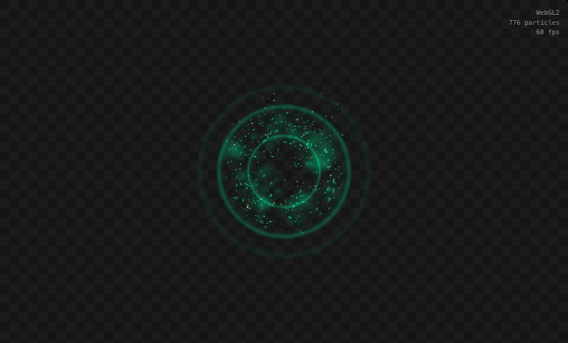
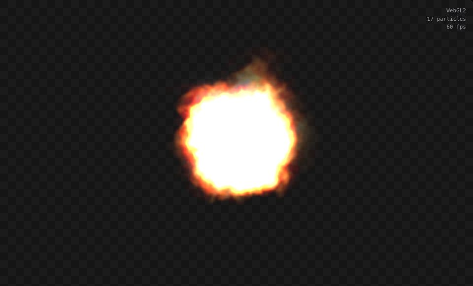
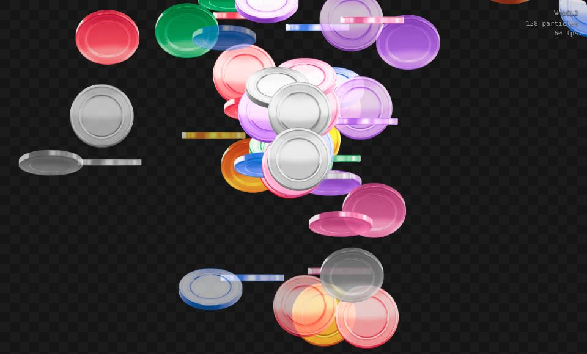
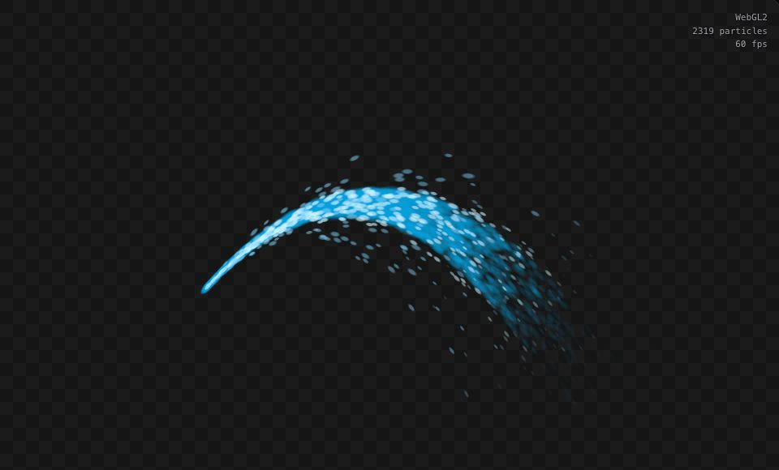

# reparticle

**GPU particle effects. Defined in JSON.**

From candle flames and drifting smoke to magical auras and showers of coins, reparticle brings particle effects to your scenes. Define how they appear, move, and fade, then let the engine bring them to life.

PixiJS is our first and primary renderer, and the renderer available today.

**[Documentation](https://reparticlejs.github.io/reparticle/docs/) · [Live examples](https://reparticlejs.github.io/reparticle/examples/) · [Interactive Lab](https://reparticlejs.github.io/reparticle/lab/) · [API](https://reparticlejs.github.io/reparticle/api/)**

## See it in action

|                                                                     Magical aura                                                                      |                                                            Fire plume                                                            |
| :---------------------------------------------------------------------------------------------------------------------------------------------------: | :------------------------------------------------------------------------------------------------------------------------------: |
| [](https://reparticlejs.github.io/reparticle/examples/) |       [](https://reparticlejs.github.io/reparticle/examples/)       |
|                                                                     Coin fountain                                                                     |                                                           Water stream                                                           |
|     [](https://reparticlejs.github.io/reparticle/examples/)      | [](https://reparticlejs.github.io/reparticle/examples/) |

[Explore all the effects →](https://reparticlejs.github.io/reparticle/examples/) Pick an effect, play it, and open its JSON to use as a starting point.

## Make it yours

- **Describe effects in JSON.** Combine emitters, shapes, movement, and colors.
- **Shape the animation.** Use curves to control how particles grow, fade, and change over time.
- **Bring your own artwork.** Use textures or animated sprite-sheet frames.
- **Fit particles into your Pixi scene.** Add an effect to a container, move it with a character, or apply masks and filters.
- **Experiment live.** Adjust settings in the [Lab](https://reparticlejs.github.io/reparticle/lab/) and see what changes.

## Add it to your app

For an existing **PixiJS v8.22.0+ (v8)** application using **WebGL2**:

```sh
npm install @reparticle/pixi
```

Create an effect and add it to your stage:

```ts
import { ParticleEffect } from '@reparticle/pixi';

const effect = new ParticleEffect(
  {
    version: 1,
    emitters: [
      {
        id: 'sparks',
        capacity: 512,
        seed: 42,
        emission: { rate: 120, shape: { type: 'point' } },
        initial: { lifetime: 2, speed: 90, size: 6 },
      },
    ],
  },
  { ticker: app.ticker },
);

effect.position.set(app.screen.width / 2, app.screen.height / 2);
app.stage.addChild(effect);
```

This uses the built-in soft particle texture. See the [quick start](https://reparticlejs.github.io/reparticle/docs/quick-start/) for app setup, or learn to [add textures and animation](https://reparticlejs.github.io/reparticle/docs/textures/).

```ts
effect.pause(); // Pause.
effect.resume(); // Continue.
effect.reset(); // Start again.
effect.stop(); // Stop emitting; let existing particles finish.
effect.destroy(); // Clean up when finished.
```

## Learn more

- [Effect configuration](https://reparticlejs.github.io/reparticle/docs/configuration/) — explore the settings behind each effect.
- [Core API](https://reparticlejs.github.io/reparticle/api/core/) — the particle engine.
- [PixiJS API](https://reparticlejs.github.io/reparticle/api/pixi/) — use effects in your PixiJS application.

## Contributing

To run the project locally, use Node.js 24+ and pnpm 10.32.1:

```sh
pnpm install
pnpm dev:site
```

Run `pnpm check` before submitting changes. Tests install Chromium automatically when needed. See the [Development guide](https://reparticlejs.github.io/reparticle/docs/development/) for the full workflow.

## License

[MIT](LICENSE). Example artwork has its own [licenses and credits](examples/shared/README.md). Particle concepts and behavior are inspired by [Defold](https://defold.com/).
